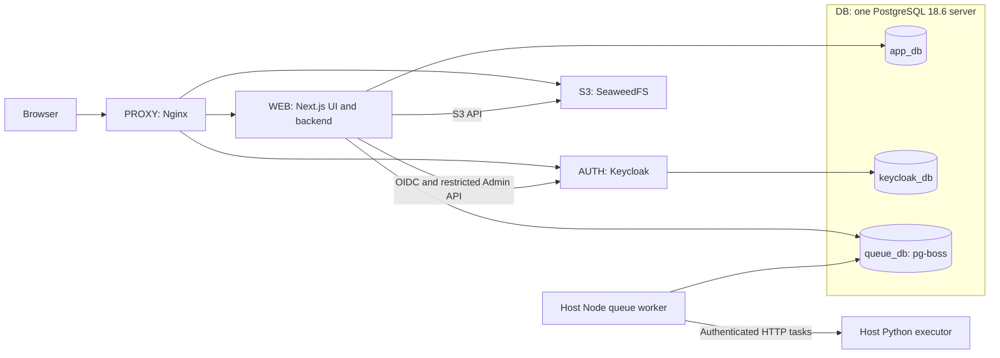

# System architecture

## Decision and implementation status

The application is one Next.js Web/backend. DEV infrastructure consists of
four core Compose roles: proxy (Nginx), db (PostgreSQL), auth (Keycloak) and s3
(SeaweedFS). Automatic DEV startup also enables s3console, for five infrastructure
containers. Web, Node queue and Python run on the host. QA adds release containers
for those applications plus a transient maintenance profile; its S3 console is
enabled separately. There is no separate cache or business API container.

PostgreSQL creates application and Keycloak databases/roles inside its startup
script; the queue bootstrap provisions its separate database and restricted role. Keycloak reconciles its managed
realm inside the same container. SeaweedFS generates S3 identities and initializes
the bucket inside its own container. Compose health checks wait for bootstrap.
Compose owns infrastructure bootstrap. Queue schema initialization and the local
Web queue connection are automatically prepared by `dev:queue:prepare` during
`pnpm dev`; `pnpm queue:setup` remains an explicit standalone provisioning command.

The database package in **packages/database** uses Prisma 7.10.1 with UUIDv7 keys,
a Keycloak-reference-only user model and explicit CLI migrations. DEV application
migration deployment and server-side login are implemented. See the
[database recipe](0303-prisma-database.md), [login recipe](0304-keycloak-login.md)
and [local Docker workflow](0302-local-docker.md). Local QA delivery is
implemented through [separate stages](0316-qa-containers.md); Terraform and PROD
deployment remain pending. A host Python executor is implemented
with a private virtualenv, authenticated diagnostics and health endpoints; see
the [Python worker recipe](0314-python-worker.md).

This decision replaces the earlier microservice and four-application proposals.
The sibling `modulon` repository supplies context and the DEV/QA/PROD model.
Its implementation, partial authentication and reported checks are not features
or validation evidence for this repository.

The Web backend streams interactive OpenAI replies and saves the completed
reply with its generation metrics. The [hybrid AI architecture](0207-ai-execution-architecture.md)
also describes the planned use of Python for small CPU models and the durable
queue for longer AI jobs.

## Selected stack

| Layer | Technology | Responsibility |
| --- | --- | --- |
| PROXY | Nginx Open Source | TLS, routing, request limits and the browser entry point |
| DB | PostgreSQL **18.6**, one server per environment | Separate application, Keycloak and queue databases |
| WEB | Next.js App Router and React | UI, SSR, Route Handlers, Server Actions and business backend in `apps/web` |
| UI | Tailwind CSS, react-bootstrap-icons, next-intl | Styling, icons from `react-bootstrap-icons`, PL/EN messages and preferences |
| Browser authentication | Better Auth in Next.js | Keycloak OIDC integration and PostgreSQL-backed application sessions |
| Database package | Prisma **7.10.1** in `packages/database` | Application schema, migrations and server-only database access |
| S3 | SeaweedFS open-source edition | S3-compatible object storage; bootstrap runs in the same container |
| S3CONSOLE | Official SeaweedFS Admin UI | Separate operator login and storage administration; included in automatic DEV startup |
| AUTH | Keycloak | Identity, credentials, MFA, realm roles, custom themes and Admin REST API |
| Queue worker | Node.js and pg-boss (DEV host, QA container) | Queue claiming, retries, schedules and delegation to Python |
| Python executor | FastAPI/Uvicorn (DEV virtualenv, QA container) | Bounded authenticated tasks and health; opt-in PostgreSQL and Node queue bridge clients |

Use a pnpm workspace and TypeScript. `prisma`, `@prisma/client` and
`@prisma/adapter-pg` are pinned to 7.10.1 in the database package. PostgreSQL 18.6 and
Prisma 7.10.1 are fixed requirements; Web dependency versions are recorded in the
[Web foundation](0204-web-foundation.md). Infrastructure image digests remain
to be selected. Upstream references:
[PostgreSQL 18.6](https://www.postgresql.org/docs/release/18.6/),
[Prisma 7.10.1](https://github.com/prisma/prisma/releases/tag/7.10.1) and
[React Bootstrap Icons](https://github.com/ismamz/react-bootstrap-icons).

NestJS, Express, a separate business API, Valkey, BullMQ, local
model servers and a telemetry backend remain outside the baseline. Host Node
and Python workers run outside the five-container DEV infrastructure. QA runs
the same workers in containers.

## Service map

Next.js handles browser application calls and accesses private dependencies.
The browser never connects to PostgreSQL or receives administration credentials.



The S3 route supports browser-reachable signed URLs when used for file transfers.
`queue_db` now has a host Node.js pg-boss consumer; see
[queue operations](0311-postgresql-queue.md).

## Next.js backend boundary

Keep one deployable application with thin transport boundaries:

```text
React UI / server rendering
  -> Route Handler or Server Action
  -> authentication, authorization and business service
  -> packages/database, S3 adapter or Keycloak API adapter
```

Server Components may call the same business services directly. Every protected
server entry point checks identity, permissions and resource ownership. UI
visibility follows server-provided capabilities; hiding a button does not enforce
access. Prisma, service credentials and provider tokens stay in server-only
modules. These boundaries do not require a separate HTTP backend.

## PostgreSQL ownership

One PostgreSQL 18.6 instance per environment hosts three logical databases with
separate roles. They share server resources and a failure domain, but retain
separate table ownership and migration lifecycles.

| Database | Owner and access | Schema lifecycle |
| --- | --- | --- |
| `app_db` | Next.js backend; business data, file metadata and Better Auth records | Prisma 7.10.1 through `packages/database` |
| `keycloak_db` | Keycloak only | Keycloak-managed migrations; never Prisma |
| `queue_db` | pg-boss producer/consumer through a separate server-only connection | pg-boss-managed schema in `modulon_queue`; never the application Prisma schema |

Web's baseline runtime role accesses only `app_db`. Keycloak uses its own role.
Bootstrap creates the queue database and restricted owner role; queue runtime
credentials are now supplied to Web and the host consumer through `QUEUE_DATABASE_URL`. Revoke
unnecessary cross-database access. Normal processes do not use owner/superuser
credentials. Bound all pools against the shared server connection budget.

`packages/database` owns the application schema, migrations, generated client
and client factory. Web supplies its runtime connection and pool. Imports must
not load the Prisma CLI's DEV env file. Use the PostgreSQL driver adapter for
Prisma 7. Better Auth's required user/account/session/verification fields belong
to this application schema and must match the selected adapter version.
Keycloak remains authoritative for identity and realm roles. See
[Better Auth's Prisma adapter](https://better-auth.com/docs/adapters/prisma).

Bootstrap, application migrations, Keycloak migrations and future queue
migrations are separate operations. Empty-volume initialization is not an
upgrade mechanism. DEV migration tooling may use a disposable shadow database;
it must never use any of the three persistent databases as its shadow target.

## Queue boundary

The queue uses pg-boss 12.38.2 in a separate PostgreSQL database. A host Node.js
consumer executes jobs with three retries after the initial attempt, heartbeat
and expiration recovery. `/admin/queue` lists the newest jobs first. A Next.js
request handler is not the consumer; run `pnpm queue:worker` separately. See
[queue setup and operation](0311-postgresql-queue.md).

The optional Python-to-Node queue bridge is a producer/status interface inside
the host Node worker, not a second consumer or business backend. Node owns
pg-boss claiming, heartbeats, retries and acknowledgement. Machine submissions
use the server-selected SYSTEM audit actor. The Python PostgreSQL helper is a
separate opt-in data connection with its own explicit credential; it does not
manage schemas or access pg-boss internals. Neither helper is connected by the
diagnostic handler automatically. See [Python connection helpers](0314-python-worker.md#optional-connection-helpers).

When a durable workflow is added, define its consumer process, retries,
idempotency, concurrency, cancellation and restart recovery. Writes to `app_db`
and `queue_db` cannot share a normal local transaction. Use an application-owned
transactional outbox and idempotent publication when business acceptance must
reliably enqueue work. That outbox belongs to the application Prisma schema;
queue internals do not.

## Storage and administration

SeaweedFS mini provides master, volume, filer and S3 in one container. Persist
object bytes and filer metadata in its existing data volume. Private S3 identity
configuration is generated in a tmpfs by the startup script. Bucket setup is
signed, idempotent and non-destructive. An optional operator-only
[S3 console](0317-s3-console.md) runs in the `tools` profile, outside normal
startup. pgAdmin is not part of the stack.

Application and operator S3 identities remain separate. Web owns object metadata
and authorization; keys alone are not permission checks. Signed URLs require a
browser-reachable S3 hostname, correct CORS and short expiry. Changing the host
after signing invalidates the signature. PROD administration remains a separate
private-operations design.

## DEV, QA and PROD

Preserve the environment model from `modulon`:

| Environment | Application | Infrastructure and configuration |
| --- | --- | --- |
| DEV | Next.js dev server on the host | Local Compose dependencies; application/package DEV env files |
| QA | Release Web container including its backend | Complete local Compose stack; QA-owned configuration and isolated state |
| PROD | Verified release Web image | Compose on an AWS Lightsail instance; Terraform provisions infrastructure |

DEV/QA have independent project names, volumes, credentials, cookie names and
configuration. Like the reference repository, standard published ports may
overlap: run DEV and QA alternately by default. Concurrent operation needs
explicit non-conflicting ports and public URLs. This repository and the sibling
stack must not share volumes or conflicting published ports.

Nginx sends DEV Web traffic to the host process and QA/PROD traffic to the Web
container. Public Keycloak issuer/callback URLs must work in the browser and
be trusted by the backend; internal addresses do not replace the canonical
issuer. See [environment configuration](0202-environment-configuration.md).

## Delivery and acceptance

1. Align placeholders with `apps/web` and `packages/database`; add workspace
   manifests and pinned dependencies. Adapt copied infrastructure/bootstrap,
   remove legacy service assumptions and add the separate queue database.
2. Add the application schema/migrations and PostgreSQL Better Auth storage;
   implement Keycloak login/logout and verified local identity mapping.
3. Add custom Keycloak themes, realm roles and restricted directory API access;
   display permitted identity/role data in the application.
4. Verify authorized S3 upload, persistence and retrieval, including denial of
   cross-user access and forbidden server operations.
5. Verify QA release builds, configuration isolation, restart persistence and
   backup restoration. Queue execution is outside baseline acceptance.
6. Prepare Terraform and PROD Compose; deploy only when separately requested.

Promote the same immutable Web image from QA to PROD with environment-specific
runtime settings. Run controlled migrations and keep a schema-compatible rollback
plan. A single Lightsail host is not highly available. Back up all three databases,
objects, filer metadata and required configuration off-host; test restoration.

Other dependency versions, image digests, domains, registry,
TLS/backup tooling and Lightsail region/capacity remain implementation choices.
Web type/lint checks, unit tests and scoped browser regressions are implemented.
Capacity and production deployment acceptance remain pending. Offline local
backup/restore and the PostgreSQL-S3 report are described in
[history and recovery](0403-data-recovery.md). Disposable local QA full-stack verification passed; its scope and
remaining gates are recorded in [QA containers](0316-qa-containers.md).

[Back to architecture](0200-architecture.md)
