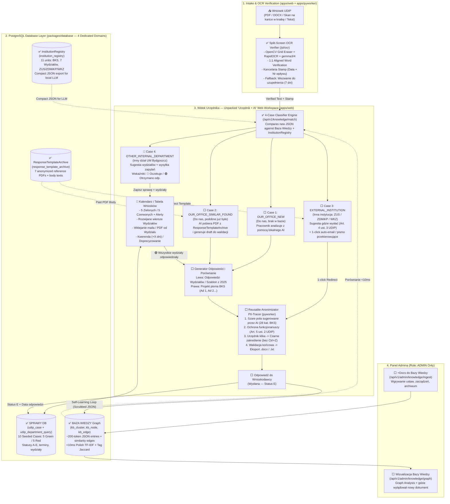

# Inteligentny Asystent Urzędnika (UM Bydgoszcz) — Complete Architecture & Progress Map

> **Legend:**
> - `✅ DONE` — Implemented, tested, and merged into `main`
> - `🚧 IN PROGRESS` — Actively being built by team
> - `⬜ TODO` — Next to implement / wire together

---

## 1. End-to-End System Architecture (Unpacking the "Urzędnik + AI" Circle)



---

## 2. Team Progress Tracker (Codebase Ground Truth)

| Layer / Module | Owner | Branch | Status | Implemented Files & Endpoints |
| :--- | :--- | :--- | :---: | :--- |
| **1. Split-Screen Handwritten OCR** | OCR / DB Dev | `main` (merged) | ✅ **DONE** | `/pl/ocr`, `POST /api/v1/ocr/analyze`, OpenCV Grid Eraser, RapidOCR + `gemma3:4b`/`gemma4:12b`, 1:1 aligned reproduction, arrow-key nav |
| **2. `SPRAWY DB` + REST API** | OCR / DB Dev | `main` (merged) | ✅ **DONE** | `UdipCase`, `UdipDepartmentQuery`, 10-case Bydgoszcz seed (`5 Green / 5 Red`), `GET/POST /api/v1/cases`, `PATCH /api/v1/cases/[uuid]`, `POST .../departments` |
| **3. `BAZA WIEDZY` + 2 Separate Tables** | OCR / DB Dev | `main` (merged) | ✅ **DONE** | `KbCluster`, `KbNode`, `KbEdge`, `InstitutionRegistry` (11 units JSON), `ResponseTemplateArchive` (7 PDFs), `<10ms` 4-case matcher, Clerk & Admin APIs |
| **4. Frontend Calendar & Table UI** | Frontend Dev | *(branch off `main`)* | 🚧 **IN PROGRESS** | Consumes `/api/v1/cases` (`5 Green / 5 Red`, expandable per-department 🔴/🟢 rows, paste email / upload PDF inline, Kwerenda / Doprecyzowanie) |
| **5. Local LLM Fallback & Draft Generator** | Backend / AI Dev | `feature/backend` | 🚧 **IN PROGRESS** | Calls `gemma3`/`gemma4` with `institutionsForLlm` JSON (Case 1, 3, 4) or `referenceTemplate` (Case 2) to generate official BKS letter (`Ad 1, Ad 2...`) |
| **6. `PII-Tracer` Anonymizer (Grey ➡️ Black)** | Backend / Frontend | *(pending)* | ⬜ **TODO** | `perplexity-ai/PII-Tracer` (~600M) + 28 BKS categories + Public Official Guard + irreversible export (`.docx` / `.txt`, no `Ctrl+Z`) |
| **7. Admin Panel Graph Visualizer** | Frontend / Admin | *(pending)* | ⬜ **TODO** | Admin-only UI consuming `/api/v1/admin/knowledge/graph` & `/ingest` to upload docs and highlight where the new node landed |

---

## 3. Architectural Notes

1. **Reusable `Anonimizator (PII-Tracer)` Placement:**
   - **Primary Gate (Always On):** Right before exporting/sending the final BKS response to the applicant (`Grey` suggestions ➡️ clerk approves ➡️ `Black` irreversible redaction, no `Ctrl+Z`) to catch any unredacted PII inside department replies.
   - **Optional 1-Click Scrub on Intake / Archival:** When saving a finished case into `Baza Wiedzy` (or if an incoming *wniosek* was not pre-redacted), `PII-Tracer` can scrub PII before archival; if already redacted, it reports `0` spans found and passes through in 1 click.
2. **Supervisor Validation Step:**
   - Maps cleanly onto existing `UdipProcessStatus`: **`D` (`PRZYGOTOWANA_ODPOWIEDZ`)** = ready for final validation/anonymization, **`E` (`ODPOWIEDZ_WYSLANA`)** = validated & sent.
3. **Teammate Database Sync Commands (after `git pull origin main`):**
   ```bash
   pnpm --filter @modulon-poc/database run build
   pnpm --filter @modulon-poc/database run db:deploy
   pnpm --filter @modulon-poc/database run db:seed:prepared
   ```
