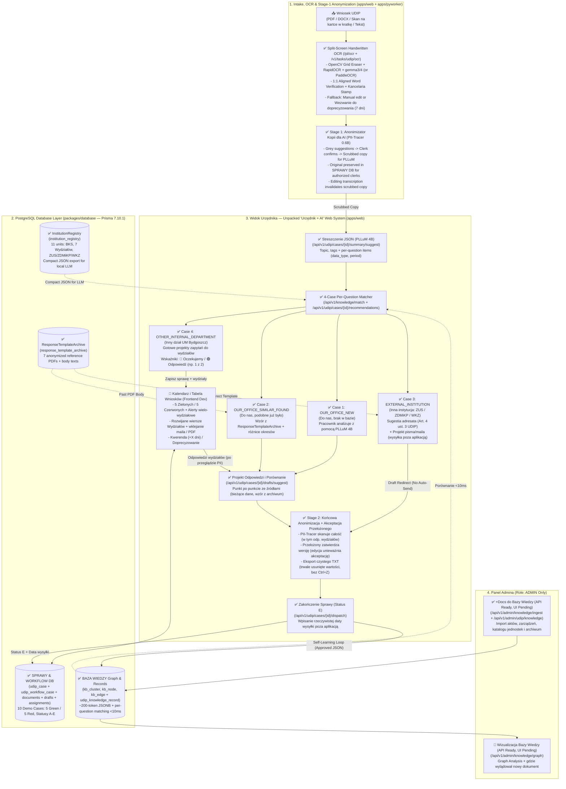

# Inteligentny Asystent Urzędnika (UM Bydgoszcz) — Unified Architecture & Progress Map (`main`)

> **Legend:**
> - `✅ DONE` — Implemented, tested, and merged into `main`
> - `🚧 IN PROGRESS` — Actively being built (Frontend UI wiring)
> - `⬜ TODO` — Final UI polish / demo integration

---

## 1. End-to-End Unified System Architecture (Aligned with UMB Competition Brief)

---

## 2. Live Team Progress Tracker on `main`

| Layer / Module | Owner | Status on `main` | Key Implemented Endpoints & Files |
| :--- | :--- | :---: | :--- |
| **1. Split-Screen Handwritten OCR** | OCR / DB Dev | ✅ **DONE** | `/pl/ocr`, `POST /api/v1/ocr/analyze`, OpenCV Grid Eraser + RapidOCR + `gemma3:4b`/`gemma4:12b`, wired as automatic fallback in `/v1/tasks/udip/ocr` |
| **2. `SPRAWY DB` & Full UDIP Workflow Backend** | Backend + DB Devs | ✅ **DONE** | 28 Prisma migrations deployed, `/api/v1/cases` + `/api/v1/udip/cases/*` (intake, documents, assignments, routing, drafts, dispatch) |
| **3. Two-Stage `PII-Tracer` + `PLLuM 4B` Engine** | Backend Dev | ✅ **DONE** | `apps/pyworker/src/pyworker/tasks/udip.py`, `apps/web/src/server/udip/pllum.ts`, `redaction-workflow.ts`, supervisor approval invalidation, clean TXT export |
| **4. `BAZA WIEDZY` + `InstitutionRegistry` + `ResponseTemplateArchive`** | DB + Backend Devs | ✅ **DONE** | `kb_cluster`, `kb_node`, `kb_edge`, `institution_registry` (11 units JSON), `response_template_archive` (7 PDFs), `/api/v1/knowledge/*`, `/api/v1/admin/knowledge/*` |
| **5. Frontend Calendar & Table UI (`5 Green / 5 Red`)** | Frontend Dev | 🚧 **IN PROGRESS** | Consumes `/api/v1/cases` & `/api/v1/udip/cases`, expandable per-department 🔴/🟢 rows (`1 z 2 odpowiedzi`), inline email paste / PDF upload |
| **6. Case Workspace & Anonymizer Review UI** | Frontend Dev | 🚧 **IN PROGRESS** | Base pages started at `/[locale]/udip/cases/[caseId]` + `transcription-review.tsx`; wire Grey ➡️ Black `PII-Tracer` review & side-by-side draft comparison |
| **7. Admin Panel Graph Visualizer UI** | OCR / DB Dev | ✅ **DONE** | Admin-only `/pl/admin/knowledge` (`requireAdminAccess`) calling `/api/v1/admin/knowledge/graph` & `/ingest` with pulsing placement highlight & 3 jury demo presets |

---

## 3. Compliance Checklist Against UMB Competition Brief

- ✅ **Browser-only (zero `.exe`), 100% local offline capable** (`gemma3:4b`/`gemma4:12b` for Vision OCR, `PLLuM 4B` for Polish JSON/drafting, `PII-Tracer 0.6B` for anonymization, with full manual fallback when models are offline).
- ✅ **No automatic email sending** — app prepares email/letter drafts; clerk confirms recipient and sends outside the app, then records actual send date to close (`Status E`).
- ✅ **Two-stage `PII-Tracer`** — Stage 1 scrubs copy before `PLLuM` (keeping original for authorized clerks); Stage 2 scrubs full final letter before supervisor approval & irreversible `.txt` export (no `Ctrl+Z` recovery).
- ✅ **Strict Clerk vs Admin API boundaries** — enforced server-side on all `/api/v1/admin/*` routes.
