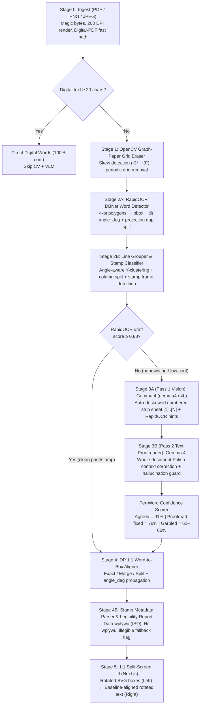

# Air-Gapped Handwritten & Scanned OCR Pipeline — Step-by-Step Technical Guide

> **System:** Inteligentny Asystent Urzędnika (UM Bydgoszcz — Biuro Komunikacji Społecznej)  
> **Goal:** Transcribe Polish handwritten & scanned UDIP requests (including graph paper / *kartka w kratkę* and tilted Kancelaria stamps) with **1:1 per-word bounding boxes**, **oriented tilt angles**, and **zero cloud/internet dependency** in **< 10 seconds** on a single consumer laptop GPU.

---

## High-Level Architecture (Stages 0–5)



---

## 1. Environment & Model Configuration

Defined in `apps/pyworker/src/pyworker/config.py`:

| Environment Variable | Default | Recommended (GPU / Demo) | Purpose |
| :--- | :--- | :--- | :--- |
| `PYWORKER_OLLAMA_URL` | `http://127.0.0.1:11434` | `http://127.0.0.1:11434` | Loopback-only guard enforced (blocks external egress). |
| `PYWORKER_OCR_VLM_MODEL` | `gemma3:4b` | **`gemma4:e4b`** (Apache 2.0) | Local multimodal model in Ollama (`gemma3:12b` also supported). |
| `PYWORKER_OCR_TIMEOUT_SECONDS` | `120` | `120` | Validated range `5–300s`. |
| `PYWORKER_OCR_MAX_BYTES` | `20971520` (20 MB) | `20971520` | Hard upload cap before decoding. |
| `PYWORKER_OCR_MAX_PAGES` | `10` | `10` | Validated range `1–25` pages per document. |
| `PYWORKER_OCR_LOW_CONFIDENCE_THRESHOLD` | `0.80` | `0.80` | Words `< 0.80` turn red for clerk `Alt+N` verification. |
| `PYWORKER_OCR_LEGIBILITY_MIN_AVG` | `0.60` | `0.60` | Flags document as `illegible_review_required` if average `< 0.60` or `> 50%` words are low-confidence. |

### Benchmarks (`Wniosek - BKS.IV.1431.16.2026.pdf` — Polish handwriting on graph paper)
- **Hardware:** Laptop RTX 3080 (local Ollama, 100% offline)
- **`gemma4:e4b` (Apache 2.0) with `"think": false`:** **8.4 – 9.8 seconds total** (Pass 1 Vision + Pass 2 Polish Proofreader + CV + RapidOCR).
- **`gemma3:12b`:** **~8.1 seconds total**.
- **Critical Gemma 4 Gotcha:** Gemma 4 enables hidden chain-of-thought thinking mode by default in Ollama. Without `"think": false`, it spends ~97s in hidden reasoning tokens and hits `num_predict` with empty output. Passing **`"think": false`** drops latency from `97s` → **`8.4s`** with full Polish transcription.

---

## 2. Stage 0 — Document Ingestion & Digital Fast-Path

File: `apps/pyworker/src/pyworker/ocr/ingest.py`

1. **Strict Magic-Byte Sniffing:** Only accepts `%PDF-`, PNG (`\x89PNG\r\n\x1a\n`), or JPEG (`\xff\xd8\xff`) regardless of filename or MIME header.
2. **Digital-PDF Fast Path:** Uses PyMuPDF (`fitz`) to extract native selectable words. If a page contains **≥ 20 characters** of native digital text, Stages 1–3 are bypassed completely and every word gets `confidence = 1.0` and `aligned_by = "digital_native"`.
3. **Scan Rasterization:** Scanned PDF pages are rasterized at **`200 DPI`**, capped at `MAX_RENDER_LONG_EDGE = 2400px` (EXIF orientation auto-corrected for images).
4. **Preview Generation:** Generates a resized PNG data URL (`MAX_PREVIEW_WIDTH = 1600px`) so the browser renders the exact same pixel coordinate system as the bounding boxes.

---

## 3. Stage 1 — OpenCV Graph-Paper Grid Eraser (*Kartka w kratkę*)

File: `apps/pyworker/src/pyworker/ocr/grid_eraser.py`

1. **Adaptive Binarization:** Converts page to grayscale and applies `cv2.adaptiveThreshold` (`ADAPTIVE_THRESH_GAUSSIAN_C`, block `25`, `C = 12`).
2. **Fine Skew Estimation (`-3.0°` to `+3.0°`):** Downscales to `900px` max edge and sweeps rotation angles (coarse `0.25°`, then fine `0.05°`) maximizing the sum of squared horizontal + vertical ink projections (`sum(row_proj^2) + sum(col_proj^2)`).
3. **Periodicity Verification:** Confirms at least **5 repeating grid lines** with consistent spacing (`12–120px`, ≥ 55% within ±25% of median spacing) so ordinary underlines or tables are NOT falsely erased.
4. **Grid Removal with Ink Preservation:** Rotates to grid-aligned space, extracts thin horizontal & vertical grid lines via morphological opening, subtracts only grid pixels that do not belong to thicker handwritten strokes, and rotates back to the **original coordinate space** so all downstream bounding boxes match the unrotated scan 1:1.

---

## 4. Stage 2A — Word Bounding-Box & Tilt-Angle Detection

File: `apps/pyworker/src/pyworker/ocr/word_detector.py`

1. **Primary Detector — RapidOCR ONNX DBNet (`rapidocr-dbnet-onnx`):**
   - Runs `RapidOCR(use_det=True, use_cls=False, use_rec=True)` locally on ONNX Runtime (~15 MB weights).
   - Returns **4-point oriented quadrilaterals** `[(x0,y0), (x1,y1), (x2,y2), (x3,y3)]` plus a draft OCR string and confidence score per region.
   - Zero-weight fallback: `MorphologicalWordDetector` (OpenCV adaptive threshold + horizontal dilation + contours) if ONNX is unavailable.
2. **Baseline Tilt Angle Detection (`angle_deg`):**
   - Computes the angle of the longer quadrilateral edge via `atan2(dy, dx)`, normalized to `[-90°, +90°]`.
   - Near-horizontal boxes (`|angle| < 1.5°`) snap to `0.0°` so straight text stays razor-crisp.
   - Tilted stamps (e.g., `-3.5°`, `-14.0°`) or rotated margin notes preserve their exact `angle_deg`.
3. **Adaptive Vertical Ink-Gap Splitting (`_split_wide_box_by_projection`):**
   - For horizontal/nearly horizontal multi-word boxes (`|angle_deg| < 6.0°` and `w >= max(36, 1.5 * h)`), projects inverted binary ink vertically, joins tiny intra-character breaks (`<= max(3, 0.05 * h)`), and splits at word gaps (`>= max(8, 0.16 * h)` capped at `0.28 * h`).
   - Intentionally keeps fine atomic ink chunks (e.g. `BYD` + `GOSZCZ`) so Stage 4's DP aligner can cleanly merge or split them using full recognized word lengths.
   - Boxes tilted `≥ 6.0°` skip vertical projection splitting so diagonal text isn't sliced across characters.

---

## 5. Stage 2B — Angle-Aware Line Grouping & Stamp Zone Classification

File: `apps/pyworker/src/pyworker/ocr/line_grouper.py`

1. **Stamp Frame Detection:** Runs Canny edge detection (`60, 160`) in the upper **35%** of the page to find rectangular Kancelaria stamp frames / barcode stickers (`1.5%–16%` page area, aspect ratio `1.1–3.8`). Boxes whose centers fall inside are tagged `zone = "stamp"`.
2. **Angle-Aware Y-Line Clustering (`_same_line`):**
   - Never merges two boxes if their tilt angles differ by **`> 12.0°`** (prevents a tilted stamp from merging with horizontal body text).
   - Merges boxes into the same line if vertical overlap `≥ 42%` of min height (or centers within `0.42 * min_h`) and height ratio `≤ 2.2×`.
3. **Column Segmentation:** Splits wide horizontal gaps (`gap > max(110px, 2.6 * min_h)`) into separate line segments (e.g. separating the left barcode sticker from the right Kancelaria stamp, or left applicant name from right city/date).
4. **Line Tilt Angle:** Each `GroupedLine` inherits the median `angle_deg` of its member boxes.

---

## 6. Stage 3 — Hybrid RapidOCR + Two-Pass Local Gemma VLM

Files: `apps/pyworker/src/pyworker/ocr/pipeline.py` & `apps/pyworker/src/pyworker/ocr/ollama_recognizer.py`

### Smart Hybrid Routing
- If RapidOCR's ONNX recognizer already read a printed/stamp line with **`draft_score >= 0.88`**, that line is kept immediately (0 ms VLM cost).
- All remaining lines (handwriting, noisy stamps, `< 0.88` confidence) are sent to **Gemma** in batches of up to **`16` lines**.

### Pass 1 — Vision Strip-Batch Recognition (`POST /api/chat`)
Instead of sending 15 slow per-line requests or a raw full page (where VLMs drop or merge lines), `_build_numbered_strip_sheet()` builds a synthetic **numbered strip sheet**:
1. Crops each uncertain line with `(8px X, 3px Y)` padding.
2. **Auto-Deskew:** If `|line.angle_deg| >= 2.5°`, rotates the crop by `line.angle_deg` using `cv2.warpAffine` with white `(255, 255, 255)` border fill so Gemma reads tilted stamps straight horizontally.
3. **Handwriting Stroke Reinforcement:** For tall handwritten lines (`h >= 42px`), applies a `2×2` elliptical erosion to slightly bold thin pen ink.
4. Resizes each strip to `target_row_h = 64px` (max width `1040px`), stamps a red **`[k]`** index label on the left (`label_w = 68px`), stacks all lines vertically with thin gray dividers, and encodes as JPEG (`quality = 90`, `max_edge = 896px`).

**Exact Ollama Request Payload (Pass 1):**
```json
{
  "model": "gemma4:e4b",
  "stream": false,
  "think": false,
  "keep_alive": "15m",
  "options": {
    "temperature": 0.0,
    "repeat_penalty": 1.05,
    "num_predict": 384,
    "num_ctx": 2048
  },
  "messages": [
    {
      "role": "system",
      "content": "Jesteś ekspertem OCR polskich wniosków o informację publiczną (Urząd Miasta Bydgoszczy). Otrzymujesz OBRAZ ponumerowanych wierszy pisma ręcznego/skanu [1]..[N] oraz wstępny OCR. Na podstawie OBRAZU i kontekstu CAŁEGO zdania po polsku odtwórz dokładne, prawdziwe polskie słowa (polskie znaki ĄĆĘŁŃÓŚŹŻąćęłńóśźż, daty DD.MM.RRRR, nazwy miast i nazwiska). Typowe pomyłki pisma ręcznego: J→I, V→U, 6→G, 2→Z, 0→O, P→D, T→Ż; łącz rozbite wyrazy (np. TRY bIE → TRYBIE, BYD GOSZCZ → BYDGOSZCZ) i nie wstawiaj kropek między literami. Zwróć TYLKO linie w formacie: [k] <poprawiony tekst>"
    },
    {
      "role": "user",
      "content": "Popraw odczyt OCR na podstawie obrazu dla wierszy [1]..[N]. Zachowaj format [k] <tekst polski>:\n[1] <rapidocr_hint_1>\n...",
      "images": ["<base64_jpeg_strip_sheet>"]
    }
  ]
}
```

### Pass 2 — Whole-Document Polish Text Proofreader (`POST /api/chat`, text-only, ~1s)
Because isolated strips can still leave single-letter handwriting ambiguities (`JLE` vs `ILE`, `OBECIA` vs `OBJĘCIA`, `BRUSWEGO` vs `BRUSKIEGO`), `_proofread_lines_context()` sends **all `[1]..[N]` lines together as plain text** (no image) so Gemma corrects typos using full Polish sentence semantics:

```json
{
  "model": "gemma4:e4b",
  "stream": false,
  "think": false,
  "keep_alive": "15m",
  "options": {
    "temperature": 0.0,
    "repeat_penalty": 1.05,
    "num_predict": "max(256, len(numbered_input) + 96)",
    "num_ctx": 2048
  }
}
```
- **Hallucination Guard:** If Pass 2 empties a line, adds `> 2` extra words, or inflates character length `> 1.6×`, the original Pass 1 line is preserved.
- **Concurrency Guard:** `asyncio.Semaphore(2)` prevents GPU VRAM exhaustion under concurrent requests.

### Per-Word Confidence Scoring (`_score_token_confidence`)
Rather than marking every handwritten word red, each word is scored individually:
- **Agreed by Pass 1 & Pass 2 (clean Polish word):** **`0.91`** → neutral/clean text (no red highlight).
- **Corrected by Pass 2 (e.g. `JLE → ILE`, `BRUSWEGO → BRUSKIEGO`):** **`0.76`** → red box so the clerk quickly confirms the AI's edit via `Alt+N`.
- **Garbled / suspicious tokens:**
  - `≥ 4` letters with **zero Polish vowels** (e.g. `ŁCPCW`) → **`0.62`** (red).
  - **Mixed internal uppercase** inside lowercase word (e.g. `obslLgi`) → **`0.64`** (red).
  - **Triple-repeated character noise** → **`0.65`** (red).
  - **Short mixed letter+digit noise** (excluding dates/signatures with `.` or `/`, e.g. `wpływu:7b`) → **`0.66`** (red).

---

## 7. Stage 4 — Deterministic DP 1:1 Word-to-Box Alignment & Metadata

Files: `apps/pyworker/src/pyworker/ocr/aligner.py` & `apps/pyworker/src/pyworker/ocr/stamp_parser.py`

1. **Exact Match (`len(tokens) == len(boxes)`):** Direct 1:1 assignment (`aligned_by = "exact"`).
2. **More Boxes Than Words (`len(tokens) < len(boxes)` → `aligned_by = "merged_box"`):**
   - Runs **Dynamic Programming (`_reduce_boxes`)** minimizing squared error between expected character-proportional word spans and actual chunk spans, rewarding word boundaries at wider whitespace gaps and penalizing merges across large gaps (e.g. merges `BYD` + `GOSZCZ` into `BYDGOSZCZ` while keeping `09.01.2026` separate).
3. **More Words Than Boxes (`len(tokens) > len(boxes)` → `aligned_by = "split_box"`):**
   - Runs **DP (`_expand_boxes`)** to assign word groups to glued boxes, then splits each glued box horizontally proportional to character lengths (`_split_box_for_tokens`).
4. **Angle Propagation:** Every `OcrWord` and `OcrLine` carries `angle_deg` (`-180..180`, default `0.0`) into the JSON contract.
5. **Kancelaria Stamp Metadata:** Regex parser extracts `received_date` (`YYYY-MM-DD`) and `registry_number` (`3468/2026`) from stamp/header lines.

---

## 8. Stage 5 — 1:1 Split-Screen Verification UI (Next.js)

Files:
- Contract schema: `apps/web/src/schemas/ocr.ts`
- Left Scan Pane: `apps/web/src/app/[locale]/ocr/scan-canvas.tsx`
- Right 1:1 Reproduction Pane: `apps/web/src/app/[locale]/ocr/transcription-pane.tsx`
- Orchestrator: `apps/web/src/app/[locale]/ocr/ocr-split-verifier.tsx`

### Visual & Interaction Guarantees
- **Identical Sheet Geometry:** Both panes share a strict `h-12` (48px) single-row header, identical `p-4` canvas padding, identical `zoom%` width, and identical `aspect-ratio: page.width / page.height` so both sheets sit at the exact same Y level.
- **Left Pane (`ScanCanvas`):** Renders the scan image with an SVG overlay (`viewBox="0 0 W H"`). Every word `<rect>` applies `transform="rotate(angle cx cy)"` when `|angle_deg| >= 1.5°`, staying **transparent** when clean, **red** when `< 80%` and unedited, and **blue** when selected.
- **Right Pane (`TranscriptionPane`):** Groups words by `page.lines`, computes a uniform body font size (`cqw` container units) so handwritten lines don't jump in font size, aligns words along baselines, and applies `transform: rotate(angleDeg)` with `transformOrigin: "left center"` on tilted lines (like rotated stamps).
- **Keyboard Workflow:** Click word to select (or double-click / press `Enter` to edit inline), `ArrowLeft` / `ArrowRight` to step through words, `Alt+N` to jump to the next red uncertain word.
- **Illegible Scan Fallback:** If `legibility.recommend_clarification` is `true`, a 1-click button generates an official **Wezwanie do uzupełnienia / doprecyzowania wniosku (7 dni)**.
- **Downstream Handoff:** Confirming verification sends the clean text to `POST /api/v1/knowledge/match` (4-Case Routing recommendation) and `POST /api/v1/cases` (creates the case in the Clerk Calendar).
