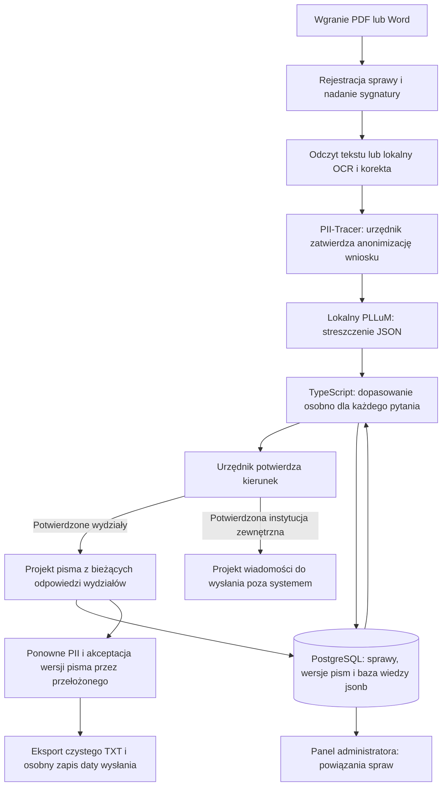

# Inteligentny Asystent Urzędnika (UM Bydgoszcz) — Complete Idea & Specification

## 1. Problem Context & Mentor Insights (Łukasz Okoński — BKS UM Bydgoszcz)

In **Urząd Miasta Bydgoszczy**, the **Biuro Komunikacji Społecznej (BKS)** coordinates responses to **~800 public information requests (UDIP)** per year under **Zarządzenie Prezydenta Miasta Bydgoszczy nr 535/2024**.

Key operational facts confirmed during our mentor session with **Łukasz Okoński** (Kierownik Referatu Komunikacji Społecznej / AIP):
1. **No `.exe` installers:** City Hall clerks need a zero-install **web application** running in the browser inside their internal network.
2. **High volume (800 requests/year) with official IDs:** Every request receives a sequential signature **`BKS.IV.1431.<nr>.<rok>`** (e.g., `BKS.IV.1431.599.2026`).
3. **Immediate External Redirection (e.g., ZUS / ZDMiKP / Konserwator Zabytków):**
   - Many incoming requests ask for data owned by another institution (e.g., ZUS, Zarząd Dróg Miejskich i Komunikacji Publicznej `17.2026`, Wojewódzki Konserwator Zabytków `15.2026`).
   - The system suggests destinations separately for each question. The clerk confirms routing and sends any external message outside the application using its prepared draft.
4. **Everything Anchored in the Calendar/Table Window:**
   - Clerks need to see **how much time is left** (`Pozostało dni`, 14-day statutory deadline under Art. 13 ust. 1 UDIP) and **process status** at a glance.
   - For the 10 test applications: **5 in Green** (safe/completed) and **5 in Red** (urgent today/tomorrow or overdue), with **Multi-Department Alerts** (`⚠️ Wielo-wydziałowy`).
   - **Expandable Per-Department Statuses:** Clicking a case row in the calendar table expands an inline view showing the status of every queried department (*Wydział 1, Wydział 2...*) and lets the clerk **attach department response files (PDF/DOCX) OR paste plain text from an email directly inside that calendar window**.
5. **Handwritten & Scanned Requests (`Porównanie dokumentów — Split-Screen OCR`):**
   - Real citizens submit handwritten requests on graph paper (*kartka w kratkę*, e.g. `Wniosek - BKS.IV.1431.16.2026.pdf`).
   - When a handwritten/scanned request is uploaded, a **Split-Screen View** shows the original scan on the left and the transcribed text on the right, with **1:1 word-level highlighting** so the clerk can verify and edit any word.
   - If the scan is so illegible that it is unclear what the applicant wants (*"nie wiadomo o co chodzi"*), the clerk clicks one button to send a **Wezwanie do uzupełnienia / doprecyzowania wniosku**.
6. **Permanent Cleanup Anonymization (`perplexity-ai/PII-Tracer`, No `Ctrl+Z`):**
   - Under § 11 ust. 8 of Zarządzenie 535/2024, departments should anonymize their replies, but in practice unredacted PII often slips through in PDF attachments or email text.
   - The clerk confirms suggested intake redactions before the sanitized request is sent to local PLLuM. After the final letter edit, PII-Tracer scans the entire letter and the supervisor approves that exact text and redaction version for TXT export.
7. **Admin-Only Knowledge Base & Visual Graph Map (`Panel Admina`):**
   - **Ordinary clerks (`Urzędnik`)** do NOT see the raw knowledge database or complex graph; they only receive fast, clear recommendations when they upload a *wniosek*.
   - **Administrators (`Panel Admina`)** have a dedicated panel to upload new laws, regulations, and archival cases, complete with a **Visual Knowledge Map** showing **where a newly uploaded document lands** in the knowledge graph.

---

## 2. End-to-End Architecture & Data Flow

The UDIP module runs inside Modulon. Next.js and TypeScript own the API, access checks, workflow, documents and precedent ranking. Prisma and PostgreSQL store cases, draft versions and the anonymized knowledge base. The local Python worker handles OCR and PII detection. Local PLLuM generates validated JSON summaries and receives only selected anonymous excerpts for drafting or routing advice. See [the backend contract](../openspec/changes/establish-udip-backend-contract/design.md) for the detailed handoff.



---

## 3. Detailed Specification of the 6 Core Modules

### Module 1: Anonymized knowledge base and routing

- Keep anonymized precedent records compact so local PLLuM receives only relevant excerpts. PostgreSQL stores records and their links. A precedent has fields such as:
  ```json
  {
    "case_id": "BKS.IV.1431.307.2025",
    "year": 2025,
    "tags": ["szkoły podstawowe", "liczba uczniów", "obcokrajowcy", "cudzoziemcy", "edukacja"],
    "summary": "Zestawienie liczby uczniów oraz uczniów cudzoziemców w szkołach podstawowych w Bydgoszczy",
    "routed_to": ["Wydział Edukacji i Sportu"],
    "is_external_authority": false,
    "external_authority": null,
    "outcome_type": "UDZIELONO_ODPOWIEDZI",
    "template_file": "Odpowiedź - BKS.IV.1431.307.2025.anonymised.pdf",
    "cluster": "edukacja_i_szkolnictwo"
  }
  ```
- Once the clerk confirms the intake redactions, local PLLuM summarizes the sanitized text in JSON with topic, tags, questions and periods. TypeScript validates the output and returns suggested units and similar cases separately for each question using approved anonymized records stored in PostgreSQL `jsonb`.
- The clerk confirms the route. Each department's reply is tracked separately. An external destination produces a draft for the clerk to send outside the application.
- The module records matched links. Administrators can inspect those links or see that placement is pending.

### Module 2: Split-Screen Handwritten OCR & Legibility Gate
Built specifically for scanned/handwritten requests like `Wniosek - BKS.IV.1431.16.2026.pdf` (Jerzy's handwritten note on graph paper asking about alcohol sales permits since Mayor Bruski took office):
1. **Preprocessing (`OpenCV Grid Eraser`):** Removes horizontal and vertical graph-paper grid lines so pen strokes stand out cleanly.
2. **Word-Level Bounding Boxes (`[x, y, width, height]`):** Every word in the handwriting gets an ID (`w1`, `w2`...), coordinates, transcribed text, and confidence score (`0.0–1.0`).
3. **Interactive Split-Screen UI:**
   - **Left:** Original scan with colored bounding boxes (Green = high confidence, Amber/Red = uncertain handwriting, Blue = Kancelaria stamp & barcode `09.01.2026`, `3468/2026`).
   - **Right:** Editable transcription where hovering/clicking any word highlights the corresponding handwritten word on the left scan.
   - **Action Buttons:**
     - `✅ Zatwierdź tekst wniosku` (Proceeds to Graph/AI recommendations)
     - `⚠️ Skan nieczytelny — Wygeneruj wezwanie do uzupełnienia / doprecyzowania` (Drafts a 7-day clarification notice to the applicant).

### Module 3: Calendar & Expandable Table Organizer (`10 Cases: 5 Green / 5 Red`)
Mirrors `WNIOSKI O UDOSTĘPNIANIE INFORMACJI PUBLICZNEJ.xlsx` while adding the mentor's requested enhancements:
- **Columns:** `Lp.`, `Numer sprawy (BKS.IV.1431.X.2026)`, `Wnioskodawca`, `Przedmiot zapytania`, `Data wpływu`, `Termin odpowiedzi`, `Pozostało dni (Deadline badge)`, `Osoba odpowiedzialna (Inicjały)`, `Status (Rozwijany A–E)`.
- **5 Green / 5 Red Visual Split:**
  - 5 cases highlighted in **Green** (comfortable time remaining or answered on time).
  - 5 cases highlighted in **Red** (deadline today/tomorrow, overdue, or awaiting urgent multi-department kwerenda).
- **Multi-Department Alert (`⚠️ Wielo-wydziałowy`):** Appears whenever a case requires input from 2+ units (e.g., `Wydział Zieleni i Gospodarki Komunalnej` + `Schronisko dla Zwierząt` in `543.2026`).
- **Expandable Row Drawer:**
  - Shows each queried department's sub-status.
  - Lets the clerk **add documents directly inside the calendar row** via file upload (`.pdf`, `.docx`) OR **paste raw email text** received from the department.
  - Includes quick actions for **Kwerenda (+X dni, Art. 13 ust. 2 UDIP)** (as in `Kwerenda - BKS.IV.1431.543.2026.pdf`) and **Wezwanie do doprecyzowania** (as in `Doprecyzowanie - BKS.IV.1431.509.2026.pdf`).

### Module 4: Document Comparison & Official BKS Letter Generator
- **Side-by-Side Comparison (`Porównanie dokumentów`):**
  - Left side: Uploaded department replies (PDF preview / pasted email text) + matched archival response from 2025.
  - Right side: Generated official UM Bydgoszcz letter with BKS header (`85-102 Bydgoszcz, ul. Jezuicka 1, bks@um.bydgoszcz.pl`), signature `BKS.IV.1431...`, structured `Ad 1, Ad 2...` paragraphs, and legal citations.
- Supports all **4 official BKS letter templates** found in the hackathon dataset:
  1. **Odpowiedź merytoryczna** (e.g., `16.2026`, `18.2026`, `293.2025`, `307.2025`, `543.2026`, `590.2026`)
  2. **Zawiadomienie o przedłużeniu terminu — Kwerenda (Art. 13 ust. 2 UDIP)** (e.g., `Kwerenda - 543.2026`)
  3. **Wezwanie do doprecyzowania / uzupełnienia zakresu wniosku (7 dni)** (e.g., `Doprecyzowanie - 509.2026` or illegible handwritten scan)
  4. **Informacja o braku dysponowania danymi — Przekierowanie (Art. 4 ust. 3 UDIP)** (e.g., `15.2026` WKZ, `17.2026` ZDMiKP, or a draft message to **ZUS**)

Drafts use replies for the current case. Archived letters serve as templates, and gaps and conflicting replies remain visible for the clerk to resolve. The clerk records the actual dispatch date separately from draft approval and export.

### Module 5: Irreversible Anonymization with `perplexity-ai/PII-Tracer`
- Powered by **`perplexity-ai/PII-Tracer`** (~600M Qwen3 bidirectional encoder) + deterministic Polish regex rules covering all **28 categories** from `Dane podlegające anonimizacji.txt` (private names, PESEL, dowód, NIP, address, private email/phone, IBAN, KW, nr działki, license plates, trade/tax/medical secrets).
- **Public Official Guard (Art. 5 ust. 2 UDIP):** Names of public officials performing public functions (e.g., *Prezydent Rafał Bruski*) are flagged as public and protected from accidental redaction.
- **Grey ➡️ Black UX (No `Ctrl+Z` needed):**
  - PII-Tracer highlights suggested ranges in grey. The clerk can accept, reject, adjust or add ranges.
  - Confirmed ranges are rendered in black from a sanitized copy. Removed text is absent from copy, export and extraction of that copy.
  - The clerk confirms intake redactions before summarization. After final editing, review the entire letter again. A supervisor approves its exact text and redaction version before a new TXT is generated with the values removed. Changes require fresh approval.

#### Download PII-Tracer for local development

Download [PII-Tracer from Hugging Face](https://huggingface.co/perplexity-ai/PII-Tracer/tree/d25c16f2e57e321f6d2527715c01df9112f956f5) before working offline. With Git and Git LFS installed, run these commands from the project root to place the model next to the project:

```powershell
git clone --no-checkout https://huggingface.co/perplexity-ai/PII-Tracer ../PII-Tracer
git -C ../PII-Tracer checkout --detach d25c16f2e57e321f6d2527715c01df9112f956f5
```

Allow about 1.2 GB for the model files, plus space for Git's local cache.

### Module 6: Admin-Only Knowledge Base & Document Placement Visualizer (`Panel Admina`)
- Accessible only to users with the **Administrator** role.
- **Live Knowledge Base Uploader (Jury Test #6):** Drag-and-drop new laws (*Ustawy*), Mayor's regulations (*Zarządzenia*), or archival responses.
- **Visual Placement Map (`Wizualizacja gdzie ląduje dokument`):** Shows the source, version, cluster and similar records in PostgreSQL. A document version enters matching after approval.

## 4. Manual fallback

If a local model is unavailable, the clerk can correct or enter the transcription, prepare a structured summary, draft from a template and mark sensitive ranges manually. The final TXT still requires supervisor approval.
