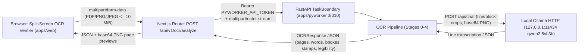

# Design

## Context

See [proposal.md](proposal.md) for product motivation, mentor context, and alignment with the 6 HackNation Jury tests.

**Current repository state (verified):**
- `apps/pyworker` (FastAPI + Uvicorn on `127.0.0.1:8010`) currently exposes only `GET /health/live`, `GET /health/ready`, and `POST /v1/tasks/check` (deterministic diagnostic checksum).
  - `src/pyworker/transport.py` enforces `Authorization: Bearer <PYWORKER_API_TOKEN>`, `Content-Type: application/json`, and `MAX_BODY_BYTES = 8192` globally on all `POST` requests.
  - `src/pyworker/config.py` bounds `PYWORKER_TASK_TIMEOUT_SECONDS` to `1..15` seconds.
  - `scripts/pyworker.mjs` manages `apps/pyworker/.venv` with hash-locked wheels (`--require-hashes --only-binary=:all:`) and an explicit env-var allowlist (`workerKeys`).
  - Both Python 3.14 and Python 3.12 are installed locally (`PYWORKER_PYTHON` supported).
- `apps/web` (Next.js 16, React 19, Tailwind CSS v4, Better Auth + Keycloak roles) already provides `requireAccess(LOGGED_ACCESS)`, same-origin upload validation (`src/app/api/v1/admin/files/upload/route.ts`), and `API_ROUTES` / `navigation.ts`.
- `docs/0207-ai-execution-architecture.md` establishes that `apps/web` owns user sessions and external API boundaries while `apps/pyworker` runs local open-weight models with no cloud API keys.
- Real target sample: `docs/Przykładowe wnioski i odpowiedzi -20261121T114640Z-1-001/Przykładowe wnioski i odpowiedzi/Wniosek - BKS.IV.1431.16.2026.pdf` (handwritten Polish block letters on black-and-white graph paper with a rectangular Kancelaria stamp and barcode sticker) plus multi-page scanned printed PDFs (`543.2026`, `590.2026`).

## Goals / Non-Goals

**Goals:**
- Deliver a 100% local, air-gap-ready 5-stage OCR pipeline (Stage 0–4) inside `apps/pyworker` using OpenCV Grid Eraser + lightweight ONNX word-box detection + local Ollama `Qwen2.5-VL-3B` line-context recognition.
- Provide an interactive Split-Screen OCR Verifier in `apps/web` with accurate `[x, y, w, h]` overlays, 1:1 hover/click/edit synchronization, Kancelaria stamp metadata extraction, and a 1-click 7-day *Wezwanie do uzupełnienia* fallback.
- Preserve strict backward compatibility for `POST /v1/tasks/check` (8 KiB JSON, 5s timeout) and all existing Modulon routes/tests.
- Keep unit and contract tests 100% deterministic and runnable offline (no GPU or live Ollama daemon required for `pnpm check`).

**Non-Goals:**
- No cloud/OpenAI Vision calls for OCR (user selected 100% local Ollama `Qwen2.5-VL-3B` for Stage 3).
- No database persistence of UDIP cases or Calendar table CRUD in this change (those belong to the Calendar/Case Organizer OpenSpec change; this change emits a clean verified payload contract that the case intake modal can embed directly).
- No irreversible PII anonymization (`PII-Tracer`) or Knowledge Graph routing in this change (separate downstream capabilities that consume the verified text output).
- No `pg-boss` async queue orchestration in this first vertical slice (synchronous bounded HTTP request with explicit 60s timeout; async queue wrapping can be added later if bulk multi-page batches exceed interactive latency).

## Architecture & Service Boundaries



### Contracts & Data Flow

#### 1. `POST /v1/tasks/ocr` (`apps/pyworker`)
- **Auth:** `Authorization: Bearer <PYWORKER_API_TOKEN>` (validated via `hmac.compare_digest`).
- **Request:** `application/octet-stream` body (max `10 MiB`, enforced by path-scoped `TaskBoundary`) with headers:
  - `X-File-Name`: URL-encoded sanitized filename
  - `X-OCR-Options`: optional JSON (`{"max_pages": 5, "include_preview_images": true}`)
  - Rationale: matches existing Modulon raw binary upload pattern (`apps/web/src/app/api/v1/admin/files/upload/route.ts`) and avoids base64 33% bloat or `python-multipart` dependency overhead.
- **Response (`200 OK`, `application/json`, max 16 MiB including optional page preview PNGs):**
```json
{
  "status": "ok",
  "executor": "pyworker",
  "engine": {
    "detector": "rapidocr-dbnet-onnx",
    "recognizer": "ollama:qwen2.5vl:3b"
  },
  "duration_ms": 1840,
  "page_count": 1,
  "assembled_text": "ILE PUNKTÓW SPRZEDAŻY ALKOHOLU PRZYBYŁO W BYDGOSZCZY...",
  "stamp_metadata": {
    "received_date": "2026-01-09",
    "registry_number": "3468/2026",
    "raw_stamp_lines": [
      "URZĄD MIASTA BYDGOSZCZY",
      "KANCELARIA OGÓLNA",
      "Data wpływu: 09.01.2026",
      "nr wpływu: 3468/2026"
    ]
  },
  "legibility": {
    "status": "legible",
    "average_confidence": 0.87,
    "low_confidence_ratio": 0.14,
    "recommend_clarification": false,
    "reason": null
  },
  "pages": [
    {
      "page_index": 0,
      "width": 1654,
      "height": 2339,
      "source_mode": "handwritten_ocr",
      "grid_removed": true,
      "preview_image_data_url": "data:image/png;base64,...",
      "lines": [
        {
          "line_id": "p0_l0",
          "zone": "handwriting",
          "bbox": [210, 645, 1180, 74],
          "text": "ILE PUNKTÓW SPRZEDAŻY ALKOHOLU",
          "word_ids": ["p0_w0", "p0_w1", "p0_w2", "p0_w3"]
        }
      ],
      "words": [
        {
          "id": "p0_w0",
          "line_id": "p0_l0",
          "text": "ILE",
          "bbox": [210, 650, 95, 62],
          "confidence": 0.94,
          "zone": "handwriting",
          "aligned_by": "exact"
        }
      ]
    }
  ]
}
```
- **Error codes (sanitized, no echoed bytes or raw exceptions):**
  - `401 unauthorized`, `408 request_timeout`, `413 body_too_large`, `415 unsupported_media_type`, `422 invalid_document` (corrupt PDF/image or > max pages), `503 busy | not_ready | ocr_model_unavailable`, `504 task_timeout`, `500 internal_error`.

#### 2. `POST /api/v1/ocr/analyze` (`apps/web`)
- **Auth & CSRF:** Same-origin check against `AUTH_BASE_URL` + `requireAccess(LOGGED_ACCESS)` (signed-in clerk or admin; rejects unauthenticated requests with `401`/`403`).
- **Request:** `multipart/form-data` with single `file` field (`.pdf`, `.png`, `.jpg`, `.jpeg`, `<= 10 MiB`), validated by magic bytes (`%PDF-`, PNG signature, JPEG SOI) before forwarding to `pyworker`.
- **Response:** Validated via Zod `ocrAnalysisResponseSchema` in `src/schemas/ocr.ts` and returned with `Cache-Control: no-store`.

#### 3. Environment Configuration & Launcher Allowlist
New explicit `PYWORKER_*` keys (added to `apps/pyworker/src/pyworker/config.py`, `apps/pyworker/.env.example`, and `workerKeys` in `scripts/pyworker.mjs`):
- `PYWORKER_OLLAMA_URL` (default `http://127.0.0.1:11434`; loopback-only unless `PYWORKER_ALLOW_PRIVATE_NETWORK=true`)
- `PYWORKER_OCR_VLM_MODEL` (default `qwen2.5vl:3b`)
- `PYWORKER_OCR_TIMEOUT_SECONDS` (default `60`, range `5..180`)
- `PYWORKER_OCR_MAX_BYTES` (default `10485760` = 10 MiB, range `65536..20971520`)
- `PYWORKER_OCR_MAX_PAGES` (default `10`, range `1..25`)
- `PYWORKER_OCR_LOW_CONFIDENCE_THRESHOLD` (default `0.80`)
- `PYWORKER_OCR_LEGIBILITY_MIN_AVG` (default `0.60`)

## Decisions

### Decision 1: Path-Scoped Body Limits & Separate Timeout Budget in `pyworker`
- **Choice:** Make `TaskBoundary` in `src/pyworker/transport.py` apply route-specific limits (`8 KiB` + `application/json` for `/v1/tasks/check`; `10 MiB` + `application/octet-stream` for `/v1/tasks/ocr`) and use `settings.ocr_timeout` (default 60s) on `/v1/tasks/ocr` while preserving `settings.task_timeout` (1..15s) on `/v1/tasks/check`.
- **Alternatives considered:**
  - *Raising global `MAX_BODY_BYTES` to 10 MiB:* Rejected because it weakens DoS protection on `/v1/tasks/check` and breaks existing unit tests in `tests/test_worker.py`.
  - *Passing S3 keys instead of bytes:* Rejected for v1 because `pyworker` currently has zero S3 credentials (least-privilege design in `docs/0314-python-worker.md`). Direct loopback byte streaming from `apps/web` keeps `pyworker` credential-free.

### Decision 2: 5-Stage Local Pipeline (Stage 0–4) with OpenCV Grid Eraser & ONNX Word Detector
- **Choice:**
  - **Stage 0 (`ingest.py`):** Use `pypdfium2` (or `pymupdf`) to inspect PDF text layers; if a page has dense selectable words (`>= 20` chars with word rectangles), emit `source_mode: "digital_text"` directly. Otherwise rasterize at `200 DPI` (capped at `2400 px` longest side) and encode a compressed PNG preview for the UI.
  - **Stage 1 (`grid_eraser.py`):** Use `opencv-python-headless` to detect repeating horizontal and vertical line segments using directional morphological opening kernels sized to >40 px (longer than typical letter strokes so `E/T/L/Ł` are preserved), verify grid periodicity (at least 5 evenly spaced rows/cols), subtract only confirmed grid pixels, and lightly inpaint stroke intersections (`cv2.inpaint` Telea radius 2).
  - **Stage 2 (`word_detector.py` + `line_grouper.py`):** Use a lightweight ONNX text/word box detector (`rapidocr-onnxruntime` DBNet detector ~15 MB, or contour-split sub-boxes when DBNet returns multi-word line polygons) to produce per-word `[x, y, w, h]` boxes. Group boxes into lines via vertical overlap clustering, sort top-to-bottom / left-to-right, and tag `stamp` zones using rectangular frame / barcode density / printed-font heuristics.
  - **Stage 3 (`ollama_recognizer.py`):** Call local Ollama (`POST /api/chat` via existing `httpx2.AsyncClient` with `trust_env=False`, `follow_redirects=False`, bounded response size) using `qwen2.5vl:3b` on each grouped line crop (or compact vertical strip of lines) with a strict Polish transcription JSON prompt requesting exact tokens + per-token certainty.
  - **Stage 4 (`aligner.py` + `stamp_parser.py`):** Align VLM line tokens 1:1 to Stage 2 `[x, y, w, h]` boxes:
    - Exact count match → 1:1 zip (`aligned_by: "exact"`).
    - Fewer VLM tokens than boxes → merge closest adjacent horizontal boxes (`aligned_by: "merged_box"`, slight confidence penalty).
    - More VLM tokens than boxes → split widest box proportionally by character length (`aligned_by: "split_box"`, confidence capped at `0.75` so clerk sees amber highlight).
    - Extract `received_date` (`dd.mm.yyyy` / `yyyy-mm-dd`) and `registry_number` (`\d+/\d{4}`) from `stamp` lines via regex.
- **Alternatives considered:**
  - *EasyOCR + PyTorch TrOCR per isolated word:* Rejected because PyTorch adds >2 GB to the venv, struggles on Python 3.14 Windows wheels, and English-pretrained TrOCR has poor accuracy on Polish diacritics without line context.
  - *Whole-page VLM without Stage 2 detector:* Rejected because `Qwen2.5-VL-3B` alone does not return reliable per-word `[x, y, w, h]` pixel coordinates for every word on graph paper, breaking the 1:1 split-screen highlighting requirement.

### Decision 3: Protocol-Based Recognizer Injection for Deterministic Offline Tests
- **Choice:** Define a Python `WordDetector` and `LineRecognizer` `Protocol` in `src/pyworker/ocr/interfaces.py`, injected into `create_app(..., ocr_pipeline=...)`.
- **Rationale:** Matches Modulon's testable factory pattern (`create_app(settings)`), allows `pnpm test:pyworker` and `pnpm check` to run 100% offline in CI/sandbox without downloading weights or running Ollama, and enables real integration tests against `Wniosek - BKS.IV.1431.16.2026.pdf` when Ollama is running.

### Decision 4: Reusable Split-Screen Verifier Component & Route Structure (`apps/web`)
- **Choice:** Build the Split-Screen OCR Verifier as a reusable client feature under `apps/web/src/app/[locale]/ocr/` (`ocr-workspace.tsx`, `scan-canvas.tsx`, `transcription-pane.tsx`, `clarification-draft-modal.tsx`) accessible via `/ocr` for any signed-in clerk (`LOGGED_ACCESS`), while keeping the core `<OcrSplitVerifier />` component decoupled from page chrome so the upcoming UDIP Calendar/Intake modal can embed it directly.
- **UI/UX details (`ui-ux-designer`):**
  - Left pane uses a relative container wrapping the rendered page image with an SVG overlay using `viewBox="0 0 {width} {height}"` so `[x, y, w, h]` coordinates scale pixel-perfectly at any viewport or zoom level (`50%–200%`) without manual resize recalculations.
  - Keyboard accessible (`Tab` through words, `Enter` to edit inline, `Escape` to cancel, `Alt+N` to jump to next uncertain amber/red word).
  - Color + non-color cues (WCAG): Green solid border (`>= 80%`), Amber dashed border + warning dot (`50–79%`), Red double border + alert icon (`< 50%`), Blue dotted border + stamp badge (`stamp` zone).

## Risks / Trade-offs

- **[Python 3.14 wheel availability for OpenCV / ONNXRuntime / PyMuPDF]** → Verify binary wheels during Track B dependency lock; `scripts/pyworker.mjs` already supports Python 3.12 (`PYWORKER_PYTHON`), which is installed locally and has guaranteed prebuilt Windows wheels for all required packages. Document `PYWORKER_PYTHON` fallback in setup notes if any wheel lacks a `cp314` binary.
- **[Morphological grid removal accidentally thinning straight letters like `I`, `L`, `T`, `E`]** → Require minimum line-segment length (>40 px) AND periodicity verification across the page before erasing, then apply small-radius Telea inpainting (`r=2`) only at grid-ink intersections; verify visually and via automated stroke-retention test on `Wniosek - BKS.IV.1431.16.2026.pdf`.
- **[DBNet returning line-level polygons instead of word-level boxes on tightly spaced handwriting]** → Include a horizontal vertical-projection gap splitter in `word_detector.py` that subdivides wide polygons into individual word boxes before Stage 4 alignment.
- **[Ollama `qwen2.5vl:3b` latency on multi-page scans or CPU-only workstations]** → Batch line crops into compact strips (or bounded concurrent Ollama calls, max 2) with explicit `PYWORKER_OCR_TIMEOUT_SECONDS=60`, expose clear loading progress in the UI, and return clean `503/504` errors if Ollama is stopped or slow.
- **[Large response payloads when embedding PNG page previews]** → Cap rasterized preview resolution to `1600 px` max width (JPEG/PNG compressed) and enforce a strict 16 MiB response cap on the Next.js server adapter.
- **[Sensitive citizen data in scanned requests]** → Never log OCR text, filenames containing names, or raw image bytes in `apps/web` or `apps/pyworker`; keep `Cache-Control: no-store` on `/api/v1/ocr/analyze` and `/v1/tasks/ocr`.

## Migration Plan

1. **Dependencies & Config (non-breaking):** Add OCR packages to `apps/pyworker/requirements.in` and regenerate hash-locked `requirements.lock`; add optional `PYWORKER_OLLAMA_*` / `PYWORKER_OCR_*` defaults to `.env.example`, `config.py`, and `scripts/pyworker.mjs`.
2. **Track B (`apps/pyworker`) & Track A (`apps/web`) in parallel:** Both tracks code against the frozen JSON contract defined above (`POST /v1/tasks/ocr` and `POST /api/v1/ocr/analyze`). Track A can develop and test the Split-Screen UI against fixture responses matching `ocrAnalysisResponseSchema` while Track B builds the Python stages.
3. **Integration & Local Ollama Verification:** Pull `qwen2.5vl:3b` on the GPU/Ollama machine (`ollama pull qwen2.5vl:3b`), start `pnpm dev`, and run an end-to-end verification on `Wniosek - BKS.IV.1431.16.2026.pdf` and `Wniosek - BKS.IV.1431.543.2026.pdf`.
4. **Rollback:** All changes are additive (new endpoints `/v1/tasks/ocr` and `/api/v1/ocr/analyze`, new `/ocr` route); removing the route registration cleanly disables the feature without impacting existing auth, files, queue, or diagnostic worker checks.
